# Datenmodell-Entwurf FEVAD (Verwaltungssoftware FF Adelberg)

Stand: 22.10.2026, Entwurf 1. Grundlage: Recherchebericht, Technologieentscheidung ASP.NET Core, Cloud-Modell mit Notbetrieb (Recherche im Projektordner).

Scope: Verwaltung und Dokumentation. **Keine** Alarmierung, keine Einsatzführung, keine Verfügbarkeitsanzeige (bleibt in aPager PRO). Einsatzdaten aus Leitstelle/alamos werden nur **nachträglich übernommen**.

---

## 1. Leitlinien für das Modell

| Nr. | Leitlinie | Warum |
|---|---|---|
| L1 | **Primärschlüssel `Guid` (UUID v7)**, nicht `int` | Der Notbetrieb im Gerätehaus legt Datensätze offline an. Mit UUIDs gibt es beim Hochladen keine Schlüsselkonflikte. UUID v7 ist zeitlich sortiert und damit indexfreundlich (`Guid.CreateVersion7()` ab .NET 9). |
| L2 | **Fachliche Nummern getrennt vom Schlüssel** | Einsatznummer `2026-017`, Inventarnummer, Personalnummer sind lesbare Felder mit eigenem Unique-Index. Offline-Einsätze bekommen eine vorläufige Nummer `N-…` und erst in der Cloud die endgültige. |
| L3 | **Historisieren statt überschreiben** | Mitgliedschaft, Abteilung, Dienstgrad, Funktion sind Zeiträume (`GueltigAb`, `GueltigBis`). Daraus berechnen sich Dienstjahre (Ehrenzeichen), Personalstand zum 31.12. und Amtszeitende. |
| L4 | **Fristen und Sätze sind Stammdaten, nie Konstanten** | Altersgrenze 65 (Debatte 67), AMR 14.2 neu gefasst 06/2026, Prüfintervalle DGUV 305-002, Entschädigungssätze je Satzung. Eigene Tabelle `Parameter` mit Gültigkeitszeitraum. |
| L5 | **Gesundheitsdaten minimal** (Art. 9 DSGVO) | Atemschutz-Vorsorge speichert nur Datum, Ergebnis-Status (geeignet / befristet / nicht geeignet) und nächste Frist, **nie den Befund**. Eigene Tabelle, eigene Policy. |
| L6 | **Audit für alles Personenbezogene** | EF-Core-Interceptor schreibt jede Änderung (wer, wann, Tabelle, Schlüssel, alte/neue Werte als JSONB) in `AuditEintrag`. Felder `ErstelltAm/Von`, `GeaendertAm/Von` an jeder Entität. |
| L7 | **Soft-Delete und Löschfristen** | `GeloeschtAm` statt physischem Löschen; der nächtliche Löschlauf (`Loeschlauf`, Hintergrunddienst) löscht oder anonymisiert nach Löschkonzept, Fristen als Parameter `Datenschutz.*`, Nachweis in `Loeschnachweis`. |
| L8 | **Zeitstempel als `timestamptz` in UTC** (`DateTimeOffset`), Anzeige in Europe/Berlin, 24-h-Format | Sommerzeitwechsel bei nächtlichen Einsätzen. Reine Datumswerte (Geburtstag, Prüfdatum) als `DateOnly`. Eingabe: Datumsfelder sind Textfelder „TT.MM.JJJJ“ mit Kalenderknopf (`DatumTagHelper` aus jedem `<input type="date">`, `DatumBinder` liest auch „24.10.26“, „24102026“, „24.10.“, „h“ = heute und ISO); Uhrzeiten sind Textfelder „HH:MM“ mit Viertelstunden-Liste (`fevad-uhrzeit`), nie eine Zeiger-Uhr (Andi, 24.10.2026). |
| L9 | **Kataloge als Tabellen** mit `Code`, `Bezeichnung`, `Sortierung`, `Aktiv` | Abteilung, Dienstgrad, Funktion, Lehrgangstyp, Qualifikation, Geräteart, Statistik-Kategorie. Ein Seed liefert die BW-Standardwerte. |
| L10 | **Notbetrieb nur anhängend** | Die drei Notbetriebs-Formulare (Anwesenheit, Einsatz-Entwurf, Prüfprotokoll) erzeugen nur neue Datensätze, ändern nie bestehende. Dadurch keine Konflikte. |

Namen im Code sind **deutsch** (Domänensprache der Feuerwehr: `Mitglied`, `Einsatz`, `Pruefung`), technische Begriffe englisch (`Repository`, `DbContext`). Umlaute im Code ausgeschrieben (`ae`, `oe`, `ue`, `ss`), in der Oberfläche natürlich korrekt.

---

## 2. Überblick

```mermaid
erDiagram
    Mitglied ||--o{ Mitgliedschaft : "hat Zeiträume"
    Abteilung ||--o{ Mitgliedschaft : ""
    Mitglied ||--o{ DienstgradZuordnung : ""
    Dienstgrad ||--o{ DienstgradZuordnung : ""
    Mitglied ||--o{ FunktionZuordnung : ""
    Funktion ||--o{ FunktionZuordnung : ""
    Mitglied ||--o{ QualifikationNachweis : ""
    Qualifikation ||--o{ QualifikationNachweis : ""
    Mitglied ||--o| AtemschutzStatus : "berechnet"
    Mitglied ||--o{ AtemschutzVorsorge : ""
    Mitglied ||--o{ AtemschutzNachweis : ""
    Mitglied |o--o| Benutzer : "Login"
    Dienst ||--o{ Anwesenheit : ""
    Mitglied ||--o{ Anwesenheit : ""
    Einsatz ||--o{ EinsatzFahrzeug : ""
    Einsatz ||--o{ EinsatzTeilnahme : ""
    Mitglied ||--o{ EinsatzTeilnahme : ""
    Fahrzeug ||--o{ EinsatzFahrzeug : ""
    Einsatz ||--o| AlarmImport : "Quelle"
    Geraeteart ||--o{ Geraet : ""
    Geraeteart ||--o{ PruefplanPosition : ""
    Geraet ||--o{ Pruefung : ""
    Fahrzeug ||--o{ Geraet : "verlastet"
    Fahrzeug ||--o{ Pruefung : "HU/UVV"
    Geraet ||--o{ Mangel : ""
```



Module und ihre Ausbaustufe:

| Modul | Gerüst (jetzt) | Später |
|---|---|---|
| Mitglieder, Abteilungen, Dienstgrade, Funktionen | ✓ | Ehrungen, Führerscheine, Erziehungsberechtigte |
| Qualifikationen und Lehrgänge | ✓ (Katalog + Nachweis mit Ablauf) | Fortbildungskonto 40 h, Voraussetzungsketten |
| Atemschutz | ✓ (Vorsorge, Nachweis, berechneter Status) | Geräte-Lebenslauf Pressluftatmer |
| Dienst/Übung mit Anwesenheit | ✓ | Einladung, Zu-/Absage, iCal, QR-Anwesenheit |
| Einsatz mit Alarm-Import | ✓ | Kostenersatz § 34, Unfallmeldung UKBW, Freigabe-Workflow |
| Fahrzeuge, Geräte, Prüfungen | ✓ | Mängel-Workflow, QR-Etiketten, Ausleihe |
| Entschädigung § 16 | ✓ | `Abrechnung` mit eingefrorenen `AbrechnungsPosten`; Sätze als Parameter `Entschaedigung.{Vorgang}.{Feld}` und `Entschaedigung.Pauschale.{Funktionscode}` |
| Jugendfeuerwehr, Kleiderkammer, Kameradschaftskasse | – | eigene Module |

---

## 3. Gemeinsame Basis

Jede Entität erbt von `Entitaet`:

| Feld | Typ | Hinweis |
|---|---|---|
| `Id` | `Guid` | UUID v7, im Code erzeugt |
| `ErstelltAm`, `ErstelltVon` | `DateTimeOffset`, `Guid?` | vom Interceptor gesetzt |
| `GeaendertAm`, `GeaendertVon` | `DateTimeOffset?`, `Guid?` | |
| `GeloeschtAm` | `DateTimeOffset?` | globaler Query-Filter blendet aus |
| `Version` | `uint` (`xmin`) | optimistische Nebenläufigkeit über PostgreSQL-Systemspalte |

Kataloge erben von `Katalogeintrag`: `Code` (unique), `Bezeichnung`, `Kurzbezeichnung`, `Sortierung`, `Aktiv`.

`Parameter` (L4): `Schluessel` (z. B. `Altersgrenze.Einsatzdienst`, `Atemschutz.Vorsorge.IntervallMonate.Unter50`), `Wert` (text), `GueltigAb`, `GueltigBis`, `Quelle` (Freitext, z. B. "Satzung 2019 § 7").

---

## 4. Mitglieder

### Mitglied (Person)

| Feld | Typ | Pflicht | Hinweis |
|---|---|---|---|
| `Personalnummer` | `string(20)` | ja | unique; aus MP-FEUER übernommen |
| `LegacyMpFeuerId` | `string?` | | interne ID aus MP-FEUER für den Migrationsabgleich |
| `Barcode` | `string?` | | MP-FEUER-Barcode, später QR für Anwesenheit |
| `Anrede`, `Titel` | | | |
| `Vorname`, `Nachname` | `string(100)` | ja | |
| `Geburtsdatum` | `DateOnly` | ja | Altersgrenzen, Jugend, alamos `birthday` |
| `Geschlecht` | enum? `Maennlich`, `Weiblich`, `Divers` | | Jahresstatistik (Spalte „weiblich“), Dienstgradbezeichnung |
| `Strasse`, `Plz`, `Ort` | | | Wohnortwechsel ist anzeigepflichtig |
| `TelefonMobil` | `string?` | | **E.164** gespeichert (`+49…`), für alamos `0049…` formatiert |
| `TelefonFestnetz`, `Email` | | | privat |
| `Beruf`, `Arbeitgeber`, `ArbeitgeberStrasse`, `ArbeitgeberPlz`, `Arbeitsort`, `ArbeitgeberTelefon`, `ArbeitgeberMobil`, `ArbeitgeberEmail` | `string?` | | Tagesverfügbarkeit; nur mit Recht `Mitglieder.Arbeitgeber` (Kommandant, Stellvertreter, Führungskraft) sichtbar |
| `Notizen` | `string?` | | |
| `FotoEinwilligungAm`, `FotoWiderrufAm` | `DateOnly?` | | Einwilligung in Fotos für die Öffentlichkeitsarbeit (Art. 7 DSGVO) mit Datum zum Nachweis; Abwählen in den Stammdaten trägt den Widerruf ab heute ein, das Datum der Einwilligung bleibt stehen |
| `Fe2ExternalId` | `Guid` | ja | = `Id`, eigenes Feld, damit die alamos-`externalDbId` auch nach einer Neuanlage stabil bleibt |
| `Fe2SyncAktiv` | `bool` | | Person wird an alamos übertragen |

Bankdaten stehen **nicht** am Mitglied, sondern in `Bankverbindung` (Abschnitt Entschädigung), nur für Kassier und Kommandant.

### Mitgliedschaft (historisiert)

| Feld | Typ | Hinweis |
|---|---|---|
| `MitgliedId`, `AbteilungId` | `Guid` | |
| `Status` | enum `Probezeit`, `Aktiv`, `Befreit`, `Ausgeschieden` | |
| `GueltigAb`, `GueltigBis` | `DateOnly`, `DateOnly?` | offener Zeitraum = aktuell |
| `Austrittsgrund` | enum? | `Altersgrenze`, `ProbezeitNichtBestanden`, `Gesundheit`, `Wohnortwechsel`, `Austritt`, `Ausschluss`, `Tod`, `Uebertritt` (Jugend → Einsatz, Einsatz → Alters) |
| `Vordienstzeit` | bool | Zeiten in anderen Wehren für Ehrenzeichen |
| `ProbezeitBis`, `ProbezeitBemerkung` | `DateOnly?`, `string?` | Ende der Probezeit, beim Eintritt vorbelegt; Verkürzung, Verlängerung oder Verzicht mit Beschluss (Satzung § 3 Abs. 2) |
| `Bemerkung` | | |

Regel: pro Mitglied höchstens eine offene Mitgliedschaft je Abteilung (Partial Unique Index `WHERE gueltig_bis IS NULL`). Probezeitende = `ProbezeitBis`, sonst `GueltigAb` + `Parameter Probezeit.Monate` (12). Probezeit gibt es nur in Einsatzabteilungen; bestanden ist sie erst mit der Bestätigung. Beim Übertritt bleiben alle Daten am Mitglied, nur Zug und Gruppe der alten Abteilung enden.

### Erziehungsberechtigter

Höchstens zwei je minderjährigem Mitglied (`Nummer` 1 oder 2): `Verhaeltnis` (Mutter, Vater, Vormund, sonstige), Name, Anschrift, `Telefon`, `Mobil`, `Email`. Gepflegt in den Stammdaten des Mitglieds, sichtbar in der Mitgliederakte mit demselben Datenbereich wie das Mitglied. Der Löschlauf löscht sie mit der Volljährigkeit (Parameter `Datenschutz.Erziehungsberechtigte.LoeschenAbAlter`, 18) oder zusammen mit den Kontaktdaten nach dem Austritt (Regel L15).

**Elternkonto:** `KontoId` verweist auf ein Benutzerkonto (Rolle `Erziehungsberechtigt`), `KontoZugeordnetAm`, `DatenschutzinformationAm` (Pflicht vor der Zuordnung), `KeineKontozuordnung` (Sperre, z. B. Sorgerechtsentzug). Zugeordnet wird nur in den Stammdaten des Kindes, also durch Jugendwart oder Kommando, nie per Selbstregistrierung; das Konto entsteht mit der E-Mail-Adresse des Erziehungsberechtigten (oder ein bestehendes Konto mit dieser Adresse wird zugeordnet, etwa das eines Mitglieds oder das Elternkonto eines Geschwisterkinds). Das Elternkonto sieht unter „Meine Termine“, im Monatskalender und im Kalender-Abo die Termine der Zielgruppe des Kindes und sagt dafür zu oder ab (`Dienstplanung.PersonenAsync`, `Elternkonten.Berechtigt`: Kind unter `Mitglied.Volljaehrigkeit.Alter`, aktiv in Jugend- oder Kinderabteilung, keine Sperre); Mitgliederdaten und Dokumente sieht es nicht (`DokumenteLesen` ohne diese Rolle), Zwei-Faktor ist keine Pflicht. Der Löschlauf hebt die Zuordnung auf, sobald die Bedingungen nicht mehr gelten, und deaktiviert Elternkonten ohne Kind (Regel L35, danach L18).

### FruehereAnschrift

Abgelöste Anschriften eines Mitglieds, `Art` `Privat` (Straße, PLZ, Ort) oder `Beruflich` (zusätzlich `Arbeitgeber`), mit `BisDatum` (Tag der Änderung). Entsteht beim Speichern der Stammdaten, wenn sich eine gefüllte Anschrift tatsächlich ändert (Groß-/Kleinschreibung und Leerzeichen zählen nicht). In der Mitgliederakte unter „Frühere Anschriften“; berufliche nur mit `Mitglieder.Arbeitgeber`. Der Löschlauf löscht sie nach `Datenschutz.Anschriften.VerlaufLoeschenNachMonate` (24) ab `BisDatum`, bei Ausgetretenen mit den Kontaktdaten (Regel L34).

### Mitgliederakte (Oberfläche)

`/Mitglieder/Akte/{id}` fasst alles zu einem Mitglied zusammen: Person, Jugendfeuerwehr (Eintritt, Austritt mit Grund, Leistungsspange oder „keine Jugendfeuerwehr“), Abteilungen, Funktionen, Dienstgrade, Ehrungen, Qualifikationen, Dienstbeteiligung und offene Punkte (Beförderung, Ehrungen, Laufbahnhinweise, Fristen, Erklärung bei Volljährigkeit). Reiter führen zu Stammdaten, Laufbahn, Ausbildung und Fristen, Ausrüstung und Anträge; jeder Teil erscheint nur mit dem passenden Recht.

### Antrag und AntragElternteil (`Domain/Mitglieder/Antrag.cs`)

Aufnahme in die Jugendfeuerwehr, Übertritt in die Einsatzabteilung mit 17, Aufnahme in die Einsatzabteilung ohne Übertritt, Erklärung bei Volljährigkeit, Wechsel in die Altersabteilung und Ausscheiden. In FEVAD ausgefüllt und als PDF (`AntragPdf`, QuestPDF) zum Unterschreiben gedruckt, oder blanko. Rechtsverbindlich ist das unterschriebene Papier; FEVAD speichert keine Unterschriften.

| Feld | Hinweis |
|---|---|
| `Art`, `Status` | Entwurf → unterschrieben eingegangen → angenommen, abgelehnt oder zurückgezogen |
| `AbteilungId` | Zielabteilung (Jugendfeuerwehr bzw. eine Einsatzabteilung); bei Altersabteilung und Ausscheiden die bisherige Abteilung |
| `MitgliedId?` | bei Übertritt, Volljährigkeit, Altersabteilung und Ausscheiden von Anfang an, bei Aufnahmen ab der Annahme |
| `Entlassungsgrund?`, `InAltersabteilung` | nur beim Ausscheiden: Grund nach Satzung § 4 Abs. 2 bzw. § 7 Abs. 3 (`Entlassungsgrund`, bewusst ohne Gesundheit, die fällt unter persönliche Gründe); ob das Mitglied nach § 6 Abs. 1 in die Altersabteilung kommt |
| Personenangaben | wie am Mitglied, `Telefon` = Festnetz |
| Vorgeschichte | nur bei Aufnahme in die Einsatzabteilung: frühere Feuerwehr mit Zeitraum, `FrueherAustrittsgrund` als Auswahl (`Ausscheidensgrund`, bewusst ohne Gesundheit), Lehrgänge und Dienstgrad als Text, andere Feuerwehr derzeit, früherer Ausschluss nur ja/nein |
| `FotoEinwilligung` | `bool?`, nicht vorbelegt |
| `EingegangenAm`, `EntschiedenAm`, `Bemerkung` | |
| `Erziehungsberechtigte` | höchstens zwei `AntragElternteil` (Tabelle `antrag_erziehungsberechtigte`) |

Unterschriften (`Antragsregeln`): Aufnahme in die Jugendfeuerwehr nur die Erziehungsberechtigten, Übertritt Jugendliche(r) und Erziehungsberechtigte, Aufnahme in die Einsatzabteilung und Volljährigkeit nur die Person. Ausscheiden Minderjähriger unterschreiben auch die Erziehungsberechtigten. Logikprüfung beim Speichern (`Antragsregeln.Fehler`): „gewünscht ab“ höchstens `Antraege.Vorlauf.Monate` (6) im Voraus; Altersgrenzen am gewünschten Tag (Jugendfeuerwehr nach Aufnahmealter, Übertritt ab `AufnahmeEinsatzAbAlter`, Aufnahme in die Einsatzabteilung ohne Übertritt erst ab `Volljaehrigkeit.Alter`, Altersabteilung auf Antrag ab `AltersabteilungAbAlter`, nichts mehr ab der Altersgrenze); ein Antrag auf Aufnahme in die Einsatzabteilung für ein Mitglied der eigenen Jugendfeuerwehr wird auf den Übertritt verwiesen, die Seite bietet die passenden Jugendlichen dafür an. Erziehungsberechtigte gibt es auf dem Antrag ohne Übertritt nicht. Was nach Satzung § 4 Abs. 1 und 5 ohne Antrag endet (Altersgrenze, Probezeit, Entscheidung des Gemeinderats), ist kein Antrag. Beim Mitglied unter Anträge stehen Knöpfe für die Anträge, die gerade möglich sind und nicht schon offen sind. Kopf der Formulare: Feuerwehr und Zielabteilung mit Anschrift, rechts das Logo (`Organisation`). Die Foto-Einwilligung wird mit Ja oder Nein beantwortet; ein Nein steht der Aufnahme nicht entgegen. Jedem Formular hängt die vollständige Datenschutzinformation nach Art. 13 DSGVO an (eine Seite, zweispaltig; bei Jugendfeuerwehr und Übertritt mit Ergänzung für die Erziehungsberechtigten). Verantwortliche ist die Gemeinde mit ihrer Anschrift aus `Organisation`; Datenschutzbeauftragter, Foto-Kanäle, Rechtsgrundlage für die Atemschutztauglichkeit, Betreiber der Alarmierung und Auftragsverarbeiter sind Text-Parameter (`Datenschutz.Beauftragter`, `Datenschutz.Fotos.Kanaele`, `Datenschutz.Art9.Grundlage`, `Datenschutz.Alarmierung.Betreiber`, `Datenschutz.Auftragsverarbeiter`), gepflegt unter Datenschutz; die Fristen kommen aus den Lösch-Parametern, dazu `Datenschutz.Restdatensatz.AufbewahrungJahre` (L7, 10) (L7, seit der Zehn-Jahres-Simulation im Löschlauf) und `Datenschutz.Einsatzberichte.AufbewahrungJahre` (L2, 10, bisher nur im Text).

Annahme (`Antragsannahme`): bei Aufnahmen entsteht das Mitglied mit Mitgliedschaft (Probezeit in der Einsatzabteilung), Erziehungsberechtigten und, wenn Zeitraum vollständig, einer Vordienstzeit; beim Übertritt endet die Jugendfeuerwehr und die Einsatzabteilung beginnt (`Uebertritt`, wie in der Laufbahn); die Volljährigkeitserklärung wird vermerkt; der Wechsel in die Altersabteilung beendet die Einsatzabteilung am Vortag; beim Ausscheiden endet die Mitgliedschaft am letzten Diensttag samt Gruppen der Abteilung, mit `InAltersabteilung` beginnt am Folgetag die Altersabteilung (ohne Altersprüfung, § 6 Abs. 1), sonst ist der Austrittsgrund Austritt bzw. Wohnortwechsel. Name, Geschlecht, Anschrift, Telefon und E-Mail aus dem Antrag gehen ins Mitglied (leere Felder lassen den bisherigen Wert stehen), damit der Datensatz der Einsatzabteilung nach dem Übertritt aktuell ist. Unter Mitglieder → Anträge stehen nur die Anträge dieses Mitglieds, offene wie abgeschlossene. Wiedereintritt (`Antrag.WiedereintrittVonId`): Ein neuer Aufnahmeantrag bietet frühere Mitglieder aus freigegebenen Abteilungen an (heute ohne Mitgliedschaft, nicht anonymisiert, nicht verstorben; bei der Jugendfeuerwehr nur frühere Jugendliche) und belegt Name, Geburtsdatum, Anschrift und Erreichbarkeit vor. Die Annahme nimmt dasselbe Mitglied wieder auf: neue Mitgliedschaft, gleiche Personalnummer, Angaben aus dem Antrag, Laufbahn und Lehrgänge bleiben (`Wiedereintritt.Hindernis`). Eine angekreuzte Foto-Einwilligung geht mit dem Eingangsdatum ins Mitglied, ein Nein widerruft eine frühere. Recht `Antraege.Bearbeiten` mit Abteilungsbezug (Kommandant, Stellvertreter, Schriftführer; Jugendwart für die Jugendfeuerwehr): sichtbar sind Anträge der freigegebenen Zielabteilung und die von Mitgliedern freigegebener Abteilungen, entscheiden darf nur, wessen Freigabe die Zielabteilung umfasst.

### Abteilung (Katalog)

`Art` (`Einsatz`, `Jugend`, `Kinder`, `Alters`, `Musik`) bestimmt die Regeln, nicht der Code; so sind mehrere Einsatzabteilungen möglich (etwa je Ortsteil). `UebergeordneteId` hängt die Kinderfeuerwehr an die Jugendfeuerwehr. Seed: fünf Einsatzabteilungen `EA`, `EA2` bis `EA5` („Einsatzabteilung 1“ bis „5“, umbenennbar, nicht gebrauchte bleiben inaktiv; eine noch „Einsatzabteilung“ genannte `EA` ohne Kurzbezeichnung wird beim Start zu „Einsatzabteilung 1“), `JF` Jugendfeuerwehr, `KF` Kinderfeuerwehr (inaktiv, steht noch nicht in der Satzung; Alter über `Kinder.Aufnahme.AbAlter` 6 und `Kinder.Ende.Alter` 10), `AA` Altersabteilung.

Jede Abteilung hat eine Anschrift (`Strasse`, `Plz`, `Ort`, beim Bearbeiten Pflicht); sie steht im Kopf der Antragsformulare. Gepflegt unter Stammdaten → Abteilungen und Funktionen (Recht `Stammdaten.Organisation`: Administrator, Kommandant, Stellvertreter). Regeln: mindestens eine aktive Einsatzabteilung; die Kinderfeuerwehr braucht eine Jugendfeuerwehr als übergeordnete Abteilung; die `Art` bleibt fest, sobald es Mitgliedschaften gibt; eine Abteilung mit aktuellen Mitgliedern oder aktiven Unterabteilungen wird nicht abgeschaltet. Neue Abteilungen bekommen den Code aus der Art plus Nummer (`EA6`). Die Grundausstattung der Kleiderkammer hängt an der Art (`Artikel.GrundausstattungArt`), gilt also für jede Einsatzabteilung.


### Organisation (`Domain/Gemeinsam/Organisation.cs`)

Genau ein Datensatz, beim Start angelegt: Name und Anschrift der Feuerwehr (`Feuerwehr*`), der Gemeinde bzw. Verwaltung als Trägerin und Verantwortliche im Sinne der DSGVO (`Gemeinde*`, dazu `GemeindeVertretung`), jeweils mit Telefon und E-Mail, und das Logo (`Logo` als `bytea`, `LogoInhaltstyp`; SVG, PNG oder JPEG, am Inhalt erkannt, höchstens 1 MB; SVG muss sich von QuestPDF lesen lassen und wird beim Abruf mit einer sandboxenden Content-Security-Policy ausgeliefert, nicht im Änderungsprotokoll). Gepflegt unter Stammdaten → Feuerwehr, Gemeinde und Logo (Recht `Stammdaten.Organisation`); die Stammdaten-Übersicht warnt, solange eine Anschrift fehlt. Lesen über `db.OrganisationAsync()`; der Jahresbericht nimmt den Namen der Feuerwehr von hier.
### Dienstgrad (Katalog) und DienstgradZuordnung

Katalog nach VwV Feuerwehrbekleidung (FM-Probe, FM, OFM, HFM, LM, OLM, HLM, BM, OBM, HBM, LHBM) mit `Sortierung` und `MindestwartezeitMonate` (12). Zuordnung: `MitgliedId`, `DienstgradId`, `Ab` (`DateOnly`), `Bemerkung`. Aktueller Dienstgrad = jüngste Zuordnung.

### Funktion (Katalog) und FunktionZuordnung

Funktionen nach FwG BW, Feuerwehrsatzung, Dienstvorschriften und UVV: Kommandant und Stellvertreter, Abteilungskommandant und Stellvertreter, Zug- und Gruppenführer, Gerätewart, Atemschutzgerätewart, Sicherheitsbeauftragter (§ 22 SGB VII, DGUV Vorschrift 1 § 20), Ersthelfer (DGUV Vorschrift 1 § 26), Ausbilder, Jugendfeuerwehrwart und Stellvertreter, Kinderfeuerwehrwart, Leiter der Altersabteilung, Kassier, Schriftführer, Kleiderwart, Kassenprüfer, Ausschussmitglied.

Katalogfelder: `Grundlage` (Rechtsgrundlage als Text), `Voraussetzungen` (Qualifikationscodes wie bei Lehrgängen, `|` oder, `;` und; Vorschläge nach VwV Feuerwehrausbildung und FwDV 2), `Abteilungsart` (die Funktion gehört zu einer Abteilung dieser Art), `AmtszeitJahre`, `VorgeschlageneRolle`, `MitWahl` (wird gewählt), `MitBeschluss` mit `BeschlussDurch` (wird bestellt bzw. bestätigt, z. B. Kommandant: Wahl durch die Hauptversammlung, dann Bestellung durch den Gemeinderat, § 6 Abs. 3 Satzung Adelberg; Jugendfeuerwehrwart: nur Wahl; Gerätewart: nur Bestellung durch den Kommandanten). Das Formular der Laufbahn zeigt nur die passenden Felder: Abteilung nur bei Abteilungsfunktionen, „gewählt am“ nur mit `MitWahl`, „Beschluss am“ nur mit `MitBeschluss`.

| Feld | Hinweis |
|---|---|
| `MitgliedId`, `FunktionId` | |
| `AbteilungId` | bei Funktionen mit `Abteilungsart`, z. B. welche Einsatzabteilung jemand führt; gibt es nur eine passende, wird sie gesetzt |
| `Art` | `Wahl` oder `Bestellung`, abgeleitet aus `MitWahl` der Funktion |
| `Wahldatum`, `Beschlussdatum` | getrennt: Tag der Wahl und Tag der Bestellung/Bestätigung; aus einer Wahl im Ausschuss-Modul kommen Sitzungstag und Zustimmung des Gemeinderats |
| `GueltigAb`, `GueltigBis` | bei Wahl automatisch `GueltigAb` + 5 Jahre als Vorschlag |
| `Beschlussdatum`, `Bemerkung` | |

**Funktion ist fachlich, Rolle ist technisch.** Eine Funktion kann eine Rolle vorschlagen (Feld `VorgeschlageneRolle` im Katalog), vergeben wird die Rolle bewusst vom Administrator. Grund: Ein Kassier braucht nicht automatisch Login-Rechte, und eine Vertretung braucht Rechte ohne Satzungsfunktion.

### Laufbahn: Übertritte, Ehrungen, Beförderungen (`Domain/Laufbahn`)

- **Übertritt, Probezeit, Ausscheiden** ändern nie eine Mitgliedschaft, sondern beenden sie am Vortag und legen eine neue an (`Mitgliedschaftswechsel`). Altersgrenzen aus Parametern: Aufnahme Einsatzabteilung ab 17, Einsatzdienst ab 18, Aufnahme Jugendfeuerwehr bis 17 (Mindestalter laut Ausschuss 10, Parameter `Jugend.Aufnahme.AbAlter`, 0 = keine Grenze), Ende Jugendfeuerwehr mit 18, Altersabteilung ab 55, Dienstende 65, Probezeit 12 Monate, Vorlauf der Hinweise 3 Monate.
- **Dienstzeit** (`Dienstzeitrechnung.Anrechnen`) nach VwV Feuerwehr-Ehrenzeichen i. d. F. vom 27.02.2025, Nr. 4:
  - Einsatzabteilung zählt; Vordienstzeiten (`Mitgliedschaft.Vordienstzeit` mit `Vordienstart`: andere Feuerwehr auch in anderen Bundesländern, Berufs- oder Werkfeuerwehr, Ausland) zählen.
  - Wehr-/Zivildienst und BFD/FSJ/FÖJ zählen nur, wenn vorher schon Feuerwehrdienst war.
  - Jugendfeuerwehr ab 14 (`Ehrung.Jugend.AnrechnenAbAlter`). Bei Eintritt ab `Ehrung.Jugend.LeistungsspangeAbEintritt` (01.01.2018) nur mit Leistungsspange (Qualifikation `LSP`); die VwV sagt „soll“, FEVAD behandelt es als Pflicht (Festlegung 22.10.2026).
  - Altersabteilung und Musikabteilung (Code `MU`) nur mit `Mitgliedschaft.EinsatzdienstBestaetigt` (Kommandant bestätigt Konzeption 65plus bzw. Grundausbildung und Übungsdienst); Altersabteilung bis 70 (`Ehrung.Altersabteilung.AnrechnenBisAlter`). Ohne Bestätigung zählt sie nicht.
  - Befreiungen (`Status` befreit mit `Befreiungsgrund`) zählen nicht, außer Krankheit und Mutterschutz; Kindererziehung bis `Ehrung.Kindererziehung.AnrechnenMonate` (12) je Befreiung, also je Kind eine Befreiung erfassen.
  - Doppelzeiten zählen einfach. Was nicht angerechnet wird, steht in `Anrechnung.NichtAngerechnet` und wird auf der Laufbahnseite rot angezeigt.
  - Zugehörigkeit (Vereinsjubiläum) = alle eigenen Abschnitte.
- **Ehrungsart** (Katalog): `Grundlage` (Einsatzdienst, Zugehörigkeit, Jahre in Funktion mit `FunktionCode`, Jahre in der Jugendfeuerwehr, nur von Hand), `Jahre`, `Reihe` (höhere Stufe ersetzt niedrigere), `VorstufeId` mit `MindestabstandJahre`, `NichtMitQualifikationen` (Codes, `text[]`), `Verleiher`, `Antragsweg`, `Kontingent` (Hinweis), `VorlaufWochen`, `MitAntragsschluss` (Verbandsehrungen, Parameter `Ehrung.Verband.Antragsschluss`, Vorschlag „30.11.“ für das Folgejahr).
  - Seed: Feuerwehr-Ehrenzeichen Bronze (15 Jahre), Silber (25), Gold (40), Gold-Sonderstufe (50) und für besondere Verdienste; Jubiläen 10 bis 60 Jahre; LFV-Ehrenmedaille Silber/Gold; DFV-Ehrenkreuz Bronze/Silber/Gold (Gold nach Silber); Deutsche Feuerwehr-Ehrenmedaille; Ehrenzeichen Bevölkerungsschutz; Traditionsnadel JF BW (2 Jahre JF ohne Jugendflamme/Leistungsspange); Ehrennadel JF BW Silber (5 Jahre Jugendfeuerwehrwart) und Gold (2 Jahre nach Silber); Ehrennadel DJF Silber/Gold (5 Jahre Abstand). KFV Göppingen und Gemeinde-Ehrungen sind pflegbar.
  - **Ehrung**: `Status` (vorgeschlagen, beantragt, verliehen, abgelehnt, verzichtet), `VoraussetzungAm`, `BeantragtAm`, `VerliehenAm`, `Urkundennummer`. Fehlt beim Erfassen die Vorstufe oder der Abstand, wird gespeichert und ein Hinweis gezeigt.
- **Befoerderungsweg** je Dienstgrad, einer genügt: `MindestjahreImDienstgrad`, `AlleQualifikationen`, `EineDerQualifikationen` (Codes, `text[]`), `ProbezeitBeendet`, `UeberspringenErlaubt` (LM mit GF, BM mit ZF), `NurVonHand`, `Hinweis`. Dazu `Dienstgrad.MindestwartezeitMonate` als Abstand zwischen zwei Beförderungen. Seed nach der Übersicht des Landratsamts Schwarzwald-Baar-Kreis zur VwV Feuerwehrbekleidung (Stand 11/2025).
- Erinnerungen laufen über `IFristQuelle` (`Laufbahnabfrage`) in die gemeinsame Fristenmail; Jugendfeuerwehr-Hinweise auch an den Jugendwart. Vorgeschlagene Verbandsehrungen erscheinen bis zum Antragsschluss.
- Probezeit und Altersgrenzen sind unter Stammdaten → Einstellungen der Abteilungen einstellbar (Recht `Laufbahn.Regeln`), jeweils als neuer Parameterwert ab heute.

### Personalprüfung und Pruefhinweis

`Personalpruefung` bewertet Mitglieder: mögliche Beförderung, fällige Ehrung, Laufbahnhinweise (Probezeit, Übertritt, Altersgrenze), Funktionen (`Funktionsanlaesse`: fehlende Voraussetzung, Ende der Amtszeit im Vorlauf) und die Erklärung bei Volljährigkeit für alle, die minderjährig in die Einsatzabteilung kamen (ab dem Vorlauf vor dem 18. Geburtstag bis `Mitglied.Volljaehrigkeit.ErinnernMonate` danach, bis eine Erklärung angenommen ist). Das Ergebnis steht in `Pruefhinweis`:

| Feld | Hinweis |
|---|---|
| `MitgliedId`, `Art` | Beförderung, Ehrung, Mitgliedschaft, Funktion |
| `Schluessel` | erkennt denselben Anlass wieder, eindeutig je Mitglied |
| `Text`, `FaelligAm`, `Pflicht` | |
| `Status` | offen, entfallen (Anlass weg, z. B. Lehrgang nachgetragen), zurückgestellt (von Hand; wird nicht erneut gemeldet) |
| `ErkanntAm`, `AbgeschlossenAm` | |

Ausgelöst wird sie vom `PruefAusloeser` (SaveChanges- und Transaktions-Interceptor): Änderungen an Mitglied, Mitgliedschaft, Dienstgrad, Funktion, Lehrgang, Ehrung oder einem Antrag zum Mitglied melden das Mitglied nach dem Commit an die `Pruefwarteschlange`; Änderungen an Regeln (Ehrungsarten, Beförderungswege, Dienstgrade, Funktionen, Qualifikationen, Parameter) melden alle. Der `PersonalpruefungDienst` arbeitet die Warteschlange ab, prüft beim Start alle (Parameter `Pruefung.GesamtlaufBeimStart`, 1) und danach täglich. Seite: Laufbahn → Prüfergebnisse. Die Hinweise sind Vorschläge, keine automatisierte Entscheidung. Der Löschlauf (L31) löscht entfallene und zurückgestellte Hinweise nach `Datenschutz.Pruefhinweise.LoeschenNachMonate` (12) und die Hinweise Ausgetretener mit der Frist von L6.

---

## 5. Qualifikationen und Lehrgänge

### Qualifikation (Katalog)

| Feld | Hinweis |
|---|---|
| `Code`, `Bezeichnung` | z. B. `TM1`, `TM2`, `SPRF`, `AGT`, `MA`, `TF`, `GF`, `ZF`, `GW`, `CSA`, `FS-C` |
| `Art` | `Lehrgang`, `Fahrerlaubnis`, `Sonstiges`, `Abzeichen` |
| `GueltigkeitMonate` | `int?`, leer = unbefristet |
| `Fe2Funktion` | `string?`, Kürzel für alamos `osFunctions` (z. B. `AGT`, `MA`); nur **gültige** Qualifikationen werden übertragen |
| `Ebene` | `Standort`, `Kreis`, `Land` |
| `VorstufeId`, `VorstufeAbstandJahre` | Stufenfolge: Vorstufe nötig, frühestens n Kalenderjahre danach; die höhere Stufe löst die Vorstufe ab |
| `Voraussetzungen` | nötige Qualifikationen als Codes, z. B. `TM1; AGT\|SPRF` (Strichpunkt: alle, senkrechter Strich: eine davon). Gilt für Abzeichen und Lehrgänge; fehlende Voraussetzungen werden beim Eintragen gemeldet, sperren aber nicht (Nachträge). Seed nach FwDV 2: TM2, SPRF, AGT, MA, TH, MOTS, JGL ← TM1; TF ← TM2; GF ← TF; ZF ← GF; VF, LDF ← ZF; AUSB ← GF; AGW ← AGT; ABC1 ← TM2 und AGT; JFW ← JGL oder GF; AGT, MA, MOTS ab 18 |
| `MindestalterJahre`, `HoechstalterJahre`, `AlterNachJahrgang` | Altersgrenzen, bei der Jugendfeuerwehr nach Jahrgang |
| `MindestJugendMonate` | Mindestdauer in der Jugendfeuerwehr (Leistungsspange 12) |

### Abzeichen

Abzeichen werden nicht beantragt, sondern am Abnahmetag erworben und als `QualifikationNachweis` erfasst (Datum,
Abnahmeort in `Lehrgangsort`, `Urkunde`). Vorbelegt: Leistungsabzeichen BW Bronze/Silber/Gold (`LA-B`, `LA-S`, `LA-G`,
Richtlinie Neufassung 2026), Geschicklichkeitsprüfung Maschinisten (`GP-MA`), Kinderfunke 1/2 (`KF1`, `KF2`),
Jugendflamme I–III (`JFL1`–`JFL3`) und Leistungsspange DJF (`LSP`). Fehlende Voraussetzungen sperren das Eintragen
nicht (Nachträge), sie werden gemeldet. Die Planungshilfe Personal → Leistungsabzeichen prüft je Mitglied der
Einsatzabteilung die Stufe und die Funktionen am Abnahmetag: Maschinist mit gültiger Fahrerlaubnis, Atemschutz mit
gültiger Eignung und Belastungsübung höchstens `Leistungsabzeichen.Belastungsuebung.HoechstensMonate` (12) alt (nur
mit Atemschutz-Recht sichtbar), Gruppenführer mit Lehrgang.

Leistungsspange als Pflicht (Festlegung Andi, 22.10.2026): Für Mitglieder der Jugendfeuerwehr mit Eintritt ab
`Ehrung.Jugend.LeistungsspangeAbEintritt` (01.01.2018) entsteht ab `Ehrung.Jugend.AnrechnenAbAlter` (14) ohne Spange
eine Frist bis zum Übertritt (`Jugend.Ende.Alter`, 18), gelb und im letzten Zeitraum
(`Jugend.Leistungsspange.WarnungTage`, 365) rot; die Wochenmail geht an `Fristen.ErinnerungJugend`. Der Jugendwart trägt Jugendabzeichen unter Abteilungen → Jugendfeuerwehr → Jugendabzeichen ein (`Jugend.Bearbeiten`, nur aktuelle Mitglieder der Jugendfeuerwehr). Ohne Spange zählt die Jugendzeit nicht für das Ehrenzeichen.

### QualifikationNachweis

| Feld | Hinweis |
|---|---|
| `MitgliedId`, `QualifikationId` | |
| `ErworbenAm` | `DateOnly` |
| `GueltigBis` | `DateOnly?`, vorbelegt aus `GueltigkeitMonate`, überschreibbar |
| `Lehrgangsort`, `Stunden`, `Bemerkung` | bei Abzeichen ist `Lehrgangsort` der Abnahmeort |
| `Urkunde` | Nummer oder Ablageort von Urkunde bzw. Besitzzeugnis |
| `DokumentId` | `Guid?`, Zeugnis-Upload (Dateiablage folgt) |

Berechnet (nicht gespeichert): Status `Gueltig`, `LaeuftAb` (Parameter `Frist.Warnung.Tage`, Default 90), `Abgelaufen`.

In der Personalakte stehen Lehrgänge und Qualifikationen getrennt von den Abzeichen, jeweils mit eigenem Eintragen-Formular.
Beim Eintragen schlägt das Formular „gültig bis“ aus `GueltigkeitMonate` bzw. `IntervallMonate` vor (`wwwroot/js/fevad.js`,
`plusMonate`); „einmalig“ im Katalog heißt ohne Ablauf.

### Lehrgangsteilnahme (`Domain/Ausbildung/Lehrgangsteilnahme.cs`, Tabelle `lehrgangsteilnahmen`)

Der Weg zum Lehrgang vor dem Nachweis. Seite Personal → Akte → „Lehrgang anmelden“ (`/Personal/Lehrgang/{Mitglied}/{Id?}`,
Recht `Ausbildung.Bearbeiten`). Offene Teilnahmen stehen oben in der Mitgliederakte unter „Offene Punkte“.

| Feld | Hinweis |
|---|---|
| `MitgliedId`, `QualifikationId` | nur Qualifikationen der Art Lehrgang |
| `AngemeldetAm`, `ZugewiesenAm` | `DateOnly?`; zugewiesen = Platzzusage, nicht vor der Anmeldung |
| `Von`, `Bis` | Zeitraum des Lehrgangs |
| `Bestanden`, `Abgeschlossen` | erst „abgeschlossen“ legt das Ergebnis fest; abgeschlossen ohne bestanden = nicht bestanden |
| `Lehrgangsort`, `Bemerkung` | |
| `NachweisId?` | bestanden und abgeschlossen legt den `QualifikationNachweis` zum letzten Lehrgangstag an; wird das Ergebnis zurückgenommen, fällt er weg |

`Stand(heute)` berechnet: angemeldet, Platz zugewiesen, läuft gerade, vorbei ohne Ergebnis, bestanden, nicht bestanden.
Teilnahmen gehören zur Ausbildung in der Personalakte und folgen deren Aufbewahrung; ein Datensatz, der endgültig gelöscht wird, nimmt sie mit.

### Nachweisart (Katalog) und Nachweis

Wiederkehrende Nachweise und Untersuchungen, z. B. Führerscheinkontrolle (`FSK`, 6 Monate) und jährliche
Unterweisung (`UVV`, 12 Monate). Weitere Arten pflegt der Kommandant unter Personal → Kataloge. Eine Art mit
`Gesundheitsbezogen` (z. B. ärztliche Untersuchung) ist nur mit Atemschutz-Recht sichtbar und eintragbar; gespeichert
werden auch dann nur Datum und Frist.

| Feld | Hinweis |
|---|---|
| `Nachweisart.IntervallMonate` | Katalogwert; daraus wird `Nachweis.GueltigBis` vorbelegt |
| `Nachweisart.Einmalig` | läuft nicht ab: `Nachweis.GueltigBis` bleibt leer, eingetragen erzeugt keine Frist mehr, fehlend bei Pflicht eine rote Frist ohne Datum |
| `Nachweisart.Pflicht` | `Keine`, `AlleEinsatzkraefte`, `MitFahrerlaubnis` (Qualifikation der Art Fahrerlaubnis), `MitQualifikation` (+ `QualifikationId`) |
| `Nachweis` | `MitgliedId`, `NachweisartId`, `Datum`, `GueltigBis?`, `DurchgefuehrtVon`, `Bemerkung` |

### Fristen (berechnet)

`Personalfristen` berechnet je aktivem Mitglied der Einsatzabteilung die Fristen aus befristeten
Qualifikationen, Pflicht-Nachweisen und – bei Inhabern der Qualifikation `AGT` – Vorsorge und den drei
jährlichen Atemschutzpflichten. Ein fehlender Pflicht-Nachweis ist rot ohne Datum. Warnfristen:
`Frist.Warnung.Tage` (Qualifikationen), `Ausbildung.Nachweis.WarnungTage`, `Atemschutz.WarnungTage`.
Intervalle je Atemschutzpflicht: `Atemschutz.Belastungsuebung|Einsatzuebung|Unterweisung.IntervallMonate` (12).
Vorschlag für die nächste Vorsorge: `Atemschutz.Vorsorge.IntervallMonate` (36), ab
`Atemschutz.Vorsorge.KuerzeresIntervallAbAlter` (50) `Atemschutz.Vorsorge.IntervallAbAlterMonate` (12). Alle Werte
ändert der Kommandant unter Personal → Einstellungen; eine Änderung legt einen neuen Parameterwert ab heute an.

Die Wochenmail (`FristErinnerung`) sammelt alle `IFristQuelle`-Implementierungen und schickt jedem Konto die
Fristen, deren Empfänger-Policy es über seine Rollen erfüllt (`Fristen.ErinnerungPersonal`,
`Fristen.ErinnerungAtemschutz`). Intervall und frühste Uhrzeit: `Frist.Erinnerung.IntervallTage`,
`Frist.Erinnerung.AbStunde`; jeder Lauf steht in `Erinnerungslauf`.

---

## 6. Atemschutz (eigene Policy `Atemschutz.Lesen`)

| Entität | Felder | Hinweis |
|---|---|---|
| `AtemschutzVorsorge` | `MitgliedId`, `UntersuchtAm`, `Ergebnis` (`Geeignet`, `GeeignetBefristet`, `NichtGeeignet`), `NaechsteFaellig`, `Bemerkung` (max. 200 Zeichen, **kein Befund**) | Art. 9 DSGVO; nur Kommandant, Stellvertreter, Atemschutzgerätewart |
| `AtemschutzNachweis` | `MitgliedId`, `Datum`, `Art` (`Einsatz`, `Belastungsuebung`, `Einsatzuebung`, `Unterweisung`), `Geraetetyp`, `Minuten`, `Taetigkeit`, `Ort`, `PaGeraet?`, `Maske?` (Nummern), `Exposition?` (Gefahrstoffe, z. B. Brandrauch), `EinsatzId?`, `DienstId?` | aus Einsatz/Dienst automatisch erzeugbar; aufbewahrt 40 Jahre (L8) |
| `AtemschutzStatus` (View/Berechnung) | `Tauglich`, `LehrgangVorhanden`, `UebungenAktuell`, `Ampel` | **Nicht gespeichert**, sondern berechnet aus Vorsorge + Nachweisen + Qualifikation `AGT`. Sperre, wenn eine der drei Übungsarten älter als 12 Monate. |

**Expositionsnachweis (KoAtEx)** nach § 14 Abs. 3 GefStoffV: in der Personalakte als PDF und CSV (`Expositionsnachweis`, Recht `Atemschutz.Lesen`), mit allen Einsätzen und Einsatzübungen sowie jedem Eintrag mit Gefahrstoff; Datum, Art, Minuten, Pressluftatmer, Maske, Gefahrstoffe, Ort und Tätigkeit. Kein ZED-Format. Dateiname `Expositionsnachweis-{Personalnummer}`, ohne Namen.

---

## 7. Dienstbetrieb: Dienst/Übung mit Anwesenheit

### Dienst

| Feld | Typ | Hinweis |
|---|---|---|
| `Art` | enum | `Uebung`, `Unterricht`, `Sonderdienst`, `Arbeitsdienst`, `Sitzung`, `Hauptversammlung`, `Veranstaltung`, `Lehrgang` (extern) |
| `Titel`, `Thema` | | |
| `Beginn`, `Ende` | `DateTimeOffset` | Default Do 19:30 für EA, Di 19:00 für JF |
| `Ort` | | Default Gerätehaus Kirchstraße 5 |
| `Abteilungen` | n:m (`dienst_abteilungen`) | Zielgruppe; leer = alle, mehrere bei gemeinsamer Übung. Planen und Ändern nur mit Recht für jede davon |
| `GruppeId` | `Guid?` | Zielgruppe zusätzlich auf eine Gruppe eingeschränkt |
| `QualifikationId` | `Guid?` | Zielgruppe zusätzlich auf Träger einer am Diensttag gültigen Qualifikation (AGT, Maschinist) |
| `SerieId` | `Guid?` | Teil einer `DienstSerie` |
| `RueckmeldungErbeten` | bool | Mitglieder der Zielgruppe sollen zu- oder absagen |
| `VerantwortlicherId` | `Guid?` | Übungsleiter; darf Rückmeldungen und Anwesenheit seines Dienstes immer ändern |
| `AlsDienst` | bool | als Dienst geplant: mit Anwesenheitsliste, eine Absage steht dort gleich als `Entschuldigt` (`ErfasstUeber = Rueckmeldung`), eine spätere Zusage nimmt das zurück; sonst nur Termin |
| `Abgeschlossen` | bool | nur Kennzeichen „fertig bearbeitet“, ändert nichts an Sichtbarkeit oder Bearbeitung |
| `Status` | enum | `Geplant`, `Durchgefuehrt`, `Abgesagt` |
| `ZaehltFuerFortbildung` | bool | 40-h-Standortfortbildung |
| `Bericht` | text | Freitext, Markdown |

### Anwesenheit

| Feld | Hinweis |
|---|---|
| `DienstId`, `MitgliedId` | unique zusammen |
| `Status` | `Anwesend`, `Entschuldigt`, `Unentschuldigt` |
| `Von`, `Bis` | `DateTimeOffset?`, leer = ganze Dienstdauer |
| `Funktion` | Freitext/Katalog (Ausbilder, Teilnehmer) |
| `ErfasstUeber` | `Web`, `Qr`, `Notbetrieb`, `Rueckmeldung` (aus Zu-/Absage übernommen) |
| `Bemerkung` | |

Stunden je Person werden aus `Von/Bis` oder der Dienstdauer **berechnet**, nicht gespeichert.

### DienstSerie

`Rhythmus` (`Woechentlich`, `Zweiwoechentlich`, `Vierwoechentlich`, `MonatlichWochentag`), `ErsterTag`, `LetzterTag`.
Die Termine werden beim Anlegen als eigenständige Dienste erzeugt (höchstens `Dienst.Serie.MaxMonate` im Voraus);
ein einzelner Termin lässt sich danach verschieben oder absagen. Änderungen können auf die folgenden Termine übertragen werden.

### Rückmeldeschluss und Meldungen

Mitglieder sagen selbst bis `Dienst.Rueckmeldung.SchlussStunden` vor Beginn zu oder ab (Seite Dienstplan → Einstellungen,
Recht `Dienste.Einstellungen`). Danach ändern nur Bearbeiter des Dienstes und der Übungsleiter, auf der Seite
`/Dienste/Meldungen/{id}`: Mitglieder markieren (z. B. alle ohne Rückmeldung) und gesammelt Zusage, Absage, anwesend,
entschuldigt oder unentschuldigt zuordnen.

### Rueckmeldung (Zu-/Absage)

| Feld | Hinweis |
|---|---|
| `DienstId`, `MitgliedId` | unique zusammen; eine neue Rückmeldung ersetzt die alte |
| `Antwort` | `Zusage`, `Absage` |
| `Begruendung` | freiwillig, nur bei Absage, nur für Führungskräfte sichtbar |
| `GemeldetAm` | `DateTimeOffset` |

Möglich bis `Dienst.Rueckmeldung.SchlussStunden` vor Beginn. Löschfristen (Vorschlag, DSB-Freigabe offen, angewendet vom Löschlauf):
Begründung nach `Dienst.Rueckmeldung.BegruendungLoeschenMonate` (3), Rückmeldung nach `Dienst.Rueckmeldung.LoeschenMonate` (12) Monaten nach dem Dienst. Führungskräfte übernehmen Zusagen als „anwesend“
und Absagen als „entschuldigt“ in die Anwesenheit, wo noch nichts erfasst ist.

### Gruppe (Katalog) und GruppenMitgliedschaft

Untergliederung der Abteilungen: `Art` `Zug` oder `Gruppe`, `AbteilungId` (leer = abteilungsübergreifend, z. B. Führungsgruppe), `UebergeordneteId` (Gruppe im Zug). Auch Zielgruppe für Dienste.

### Kalender-Abo

`Benutzer.KalenderToken` ist der geheime Teil des iCal-Links `/kalender/{token}.ics`. Der Feed enthält nur die Termine
der eigenen Zielgruppe (`Dienst.Kalender.RueckblickMonate` zurück, `Dienst.Kalender.VorschauMonate` voraus) und die
eigene Rückmeldung, keine Namen anderer Mitglieder. Neu erzeugen macht den alten Link ungültig.

---

## 8. Einsatz mit Import aus Leitstelle/alamos

Der Einsatzbericht ist die Drehscheibe: daraus entstehen später Entschädigung, Atemschutznachweise, Prüfungen nach Gebrauch, Kostenersatz und Jahresstatistik. Der Ablauf: **Alarmdaten kommen als Entwurf, der Einsatzleiter ergänzt, der Kommandant gibt frei.**

### AlarmImport (Rohdaten, getrennt vom Bericht)

Warum getrennt: Die Rohdaten unterliegen der 6-Monats-Grenze für Alarmdaten (IM BW, § 35 Abs. 6 FwG) und werden danach gelöscht. Der Einsatzbericht selbst bleibt länger (Dokumentationspflicht, Kostenersatz bis 10 Jahre).

| Feld | Typ | Quelle |
|---|---|---|
| `Quelle` | enum `Fe2Webhook`, `Fe2Feedback`, `Manuell`, `MpFeuerMigration` | |
| `ExterneId` | `string` | alamos `externalId` bzw. Leitstellen-Einsatznummer; unique je Quelle (Idempotenz) |
| `EmpfangenAm` | `DateTimeOffset` | |
| `Rohdaten` | `jsonb` | komplette Payload, da das FE2-HTTP-Ausgangsformat erst an der echten Instanz getestet wird |
| `Verarbeitet` | bool | |
| `EinsatzId` | `Guid?` | erzeugter oder zugeordneter Einsatz |
| `LoeschenAb` | `DateOnly` | `EmpfangenAm` + 6 Monate |

Rückmeldungen (`GET /rest/addressbook/external/{alarmId}/feedback`) landen ebenfalls als `AlarmImport` mit Quelle `Fe2Feedback` und befüllen Vorschläge für `EinsatzTeilnahme` (Status `YES`/`HERE` → Vorschlag "teilgenommen").

### Einsatz

| Feld | Typ | Hinweis / Import-Mapping |
|---|---|---|
| `Einsatznummer` | `string(20)` | Format aus Parameter `Einsatz.Nummer.Format` (Standard `{JJJJ}-{NNN}`), laufend je Kalenderjahr der Alarmierung, unique; offline `N-…` |
| `LeitstellenNummer` | `string?` | ← `externalId` (FE2), MP-FEUER `Leitstellen_Nr` |
| `Stichwort` | `string?` | ← `keyword`, z. B. "B 2", "TH 1" |
| `StichwortBeschreibung` | `string?` | ← `keyword_description` |
| `StichwortKategorie` | `string?` | ← `keyword_category` |
| `Meldung` | text | ← `keyword_misc` + `message[]` (zeilenweise) |
| `Strasse`, `Hausnummer`, `Plz`, `Ort`, `Ortsteil` | | ← `location.street/house/postalCode/city/district` |
| `Objekt` | `string?` | ← `building` |
| `Latitude`, `Longitude` | `double?` | ← `location.coordinate` |
| `Alarmiert` | `DateTimeOffset` | Pflicht; ← `timestamp` |
| `Ausgerueckt` | `DateTimeOffset?` | erstes Fahrzeug |
| `EintreffenEinsatzort` | `DateTimeOffset?` | |
| `Einsatzende` | `DateTimeOffset?` | |
| `EinsatzbereitschaftHergestellt` | `DateTimeOffset?` | Entschädigung und Kostenersatz rechnen bis hier |
| `StatistikKategorieId` | `Guid` | **Pflicht bei Freigabe**: Brand, Technische Hilfe, Rettungsdienstlich, Sonstige, Fehlalarm (Landesstatistik) |
| `RechtsgrundlageArt` | enum | `Para2Abs1` (Pflichtaufgabe, grundsätzlich unentgeltlich), `Para2Abs2` (immer kostenpflichtig) |
| `Einsatzleiter` | `Guid?` | Mitglied |
| `Lagebericht`, `Massnahmen` | text | |
| `Gerettete`, `Verletzte`, `Tote`, `VerletzteFeuerwehr` | `int` | Landesstatistik |
| `Ueberoertlich` | bool | Überlandhilfe |
| `Status` | enum | `Entwurf`, `InBearbeitung`, `Freigegeben` |
| `FreigegebenAm`, `FreigegebenVon` | | nach Freigabe nur noch Kommandant änderbar, jede Änderung im Audit |
| `ErfasstImNotbetrieb` | bool | |

Kostenersatz (Tatbestand, Kostenpflichtiger, Sonderlöschmittel) und Unfallmeldung kommen als eigene Tabellen in einem späteren Schritt, damit die Personenbezüge Betroffener getrennt und gezielt löschbar bleiben.

Die **Kostenaufstellung zum Kostenersatz** (`KostenersatzPdf`, `/Einsaetze/Bericht/{id}?handler=Kostenersatz`) fasst Einsatzdaten, Rechtsgrundlage, Kostenpflichtige (Beteiligte mit Rolle Verursacher), Posten nach Kostensätzen und Summe zusammen; sie ist die Grundlage für den Bescheid der Gemeinde, kein Bescheid. Wegen der Verursacherdaten nur mit `Einsaetze.Beteiligte`. Dateiname `Kostenersatz-{Einsatznummer}.pdf`.

### EinsatzFahrzeug

`EinsatzId`, `FahrzeugId`, `Ausgerueckt`, `Eingetroffen`, `Zurueck`, `Einsatzbereit` (alles `DateTimeOffset?`), `Kilometer` (`int?`). Verknüpfung zu FE2-`vehicles[]` über den **exakten Funkrufnamen**.

### EinsatzTeilnahme

`EinsatzId`, `MitgliedId`, `EinsatzFahrzeugId?`, `Funktion` (Maschinist, Gruppenführer, Angriffstrupp, …), `Von`, `Bis`, `Atemschutz` (bool, Minuten → erzeugt `AtemschutzNachweis`), `Quelle` (`Manuell`, `Fe2Rueckmeldung`), `Bestaetigt` (Self-Service-Bestätigung durch das Mitglied).

---

## 9. Fahrzeuge, Geräte, Prüfungen

### Fahrzeug

| Feld | Hinweis |
|---|---|
| `Funkrufname` | unique, z. B. "Florian Adelberg 43"; **muss exakt der FE2-Einsatzmittelkennung entsprechen** |
| `Typ` | HLF 10, TLF 8/18, MTW, Anhänger |
| `Kennzeichen`, `Hersteller`, `Aufbau`, `Baujahr`, `IndienstAm`, `AusserDienstAm` | |
| `Issi`, `FmsKennung` | TETRA-Kennungen |
| `Sitzplaetze` | |
| `PruefvorlageId?` | Geräteart mit `FuerFahrzeuge`, liefert den Prüfplan (HU, UVV) |

Seed für Entwicklung: HLF 10 (43, 2023), TLF 8/18 (21, 1986), MTW (19, 1999), Schlauchanhänger (1999).

### Geraeteart (Katalog) und PruefplanPosition

`Geraeteart`: `Bezeichnung` (z. B. "Hydraulisches Rettungsgerät", "Steckleiter", "Haltegurt"), `AussonderungNachJahren?` (Lebensdauer ab Herstellung), `Pruefgrundlage` (Text, z. B. "DGUV 305-002 Tab. 1"), `FuerFahrzeuge` (Prüfvorlage für Fahrzeuge). Der Seed liefert 17 Gerätearten nach DGUV 305-002 Tab. 1 sowie Vorschläge für Elektro, Fahrzeuge und Sonstiges.

`PruefplanPosition` (n je Geräteart): `Pruefart` (`Sichtpruefung`, `Funktionspruefung`, `Belastungspruefung`, `NachGebrauch`, `Hersteller`, `Hauptuntersuchung`, `Uvv`, `Elektro`), `IntervallMonate` (0 = keine feste Frist), `Pruefer` (Text), `Checkliste` (`jsonb`: Liste von `Pruefpunkt` mit Typ Ja/Nein, Messwert mit Einheit, Text). JSONB ist hier bewusst gewählt: Checklisten ändern sich, und jedes Protokoll speichert den Stand, mit dem geprüft wurde.

Fälligkeit (`Pruefplanung`, berechnet, nie gespeichert): je Position zählt die jüngste **bestandene** Prüfung derselben Prüfart; ohne Prüfung ist die Position sofort fällig (rot). Warnfrist aus Parameter `Technik.Pruefung.WarnungTage`, Aussonderung mit `Frist.Warnung.Tage`.

### Geraet

`Inventarnummer` (unique), `GeraeteartId`, `Bezeichnung`, `Hersteller`, `Typ`, `Seriennummer`, `Baujahr`, `Herstelldatum`, `Groesse` (PSA), `BeschafftAm`, `Anschaffungspreis`, `IndienstAm`, `AusgesondertAm`, `Aussonderungsgrund`, `FahrzeugId?` (verlastet auf), `Lagerort` (Fach), `BeschaffungId?`. Der QR-Code am Gerät enthält `{OeffentlicheAdresse}/g/{Inventarnummer}`: Technik-Berechtigte landen auf der Geräteseite, alle anderen bei „Mangel melden“. Der Zustand (einsatzbereit, eingeschränkt, außer Betrieb, ausgesondert) wird aus offenen Mängeln berechnet.

### Pruefung (Prüfprotokoll)

| Feld | Hinweis |
|---|---|
| `GeraetId?` oder `FahrzeugId?` | genau eins gesetzt (Check-Constraint) |
| `PruefplanPositionId?` | |
| `Pruefart`, `Datum` | |
| `Ergebnis` | `Bestanden`, `BestandenMitMaengeln`, `NichtBestanden`, `Ausgesondert` |
| `Ergebnisse` | `jsonb`: ausgefüllte Checkliste mit Messwerten |
| `NaechsteFaellig` | vorbelegt aus Intervall |
| `PrueferId` | Mitglied; muss Qualifikation `GW` oder Bestellung "befähigte Person" haben |
| `PrueferExtern` | Firma bei Herstellerprüfung |
| `EinsatzId?` | Prüfung nach Gebrauch |
| `Abgeschlossen` | nach Abschluss **unveränderlich** (Korrektur nur als neue Prüfung mit Verweis); PDF über QuestPDF |
| `ErfasstImNotbetrieb` | |

Aufbewahrung: über die gesamte Nutzungsdauer des Geräts (DGUV 305-002).

### Mangel

`GeraetId?`/`FahrzeugId?`, `GemeldetVon`, `GemeldetAm`, `Beschreibung`, `Schwere` (`Info`, `Einschraenkung`, `AusserBetrieb`), `Status` (`Offen`, `InArbeit`, `Behoben`), `BehobenAm`, `Massnahme`, `PruefungId?`. Melden darf jedes Mitglied (`Technik.MaengelMelden`), bearbeiten der Gerätewart. Entsteht auch aus einer Prüfung mit Mängeln und aus „beschädigt“ bei der Inventur.

### Inventur

`Inventur`: `Bezeichnung`, `Stichtag`, `FahrzeugId?` (leer = ganzer Bestand), `AbgeschlossenAm`. `InventurPosition` je Gerät mit `SollStandort` (Stand beim Anlegen), `Befund` (`Vorhanden`, `Beschaedigt`, `Fehlt`, leer = nicht erfasst), `ErfasstAm/Von`, `Bemerkung`. Nach dem Abschluss unveränderlich.

### Beschaffung

`Bezeichnung`, `Menge`, `Begruendung`, `Prioritaet`, `Status` (`Bedarf` → `Angemeldet` → `Genehmigt` → `Bestellt` → `Geliefert`, jederzeit `Abgelehnt`), `GeraeteartId?`, `FahrzeugId?`, `MangelId?` (Ersatzbeschaffung), `Haushaltsjahr`, `Kostenschaetzung` (gesamt), `Foerderfaehig`, `GenehmigtAm/Von`, `Lieferant`, `Bestellnummer`, `BestelltAm`, `GeliefertAm`, `Istkosten`. Genehmigen nur Kommandant und Stellvertreter (`Beschaffung.Freigeben`); beim Eingang entstehen Geräte mit Verweis auf die Beschaffung.

---

## 10. Benutzer, Rollen und Rechte

`Benutzer` ist der Identity-User (`IdentityUser<Guid>`), mit optionalem Verweis `MitgliedId` (1:1, eindeutig, beim Löschen des Mitglieds `NULL`). Getrennt, weil nicht jedes Mitglied einen Login hat (Jugend, Altersabteilung) und ein Gemeinde-Lesezugang kein Mitglied ist. Dazu `LetzteAnmeldungAm`, `DeaktiviertAm` und `AnonymisiertAm`: Konten werden zuerst deaktiviert; nach `Datenschutz.Konto.LoeschenNachDeaktivierungMonate` leert der Löschlauf Name, E-Mail, Passwort, Telefon, Kalender-Token und Rollen, die ID bleibt für Protokoll und Lesebestätigungen. Änderungen an Konten und Rollenvergaben schreibt der Audit-Interceptor mit, Passwort-Hash und Sicherheitsstempel nur als „geändert“.

Rollen (technisch, in Identity):

| Rolle | Kernrechte | 2FA Pflicht |
|---|---|---|
| `Administrator` | Benutzer, Rollen, Kataloge, Parameter | ja |
| `Kommandant` | alles fachlich, Freigaben, Atemschutz | ja |
| `Stellvertreter` | wie Kommandant | ja |
| `Fuehrungskraft` | Dienste und Anwesenheit schreiben, Einsatzentwürfe, Mitglieder lesen (ohne Gesundheit, Bank) | empfohlen (nicht erzwungen) |
| `Geraetewart` | Fahrzeuge, Geräte, Prüfungen, Mängel | ja |
| `Atemschutzgeraetewart` | Atemschutz (Vorsorge, Nachweise), Atemschutzgeräte | ja |
| `Jugendwart` | Mitglieder und Dienste **nur der Jugendfeuerwehr** | ja |
| `Kassier` | Entschädigung, Kameradschaftskasse (spätere Module) | ja |
| `Schriftfuehrer` | Dienste/Sitzungen, Protokolle, Mitgliederliste lesen | ja |
| `Mitglied` | eigene Daten, eigene Fristen und Stunden, Dienstplan, Mangel melden | nein |
| `GemeindeLesen` | Berichte und Statistik lesen (optional) | ja |

Die Tabelle zeigt die **Vorbelegung**. Was eine Rolle darf, pflegt der Administrator unter Verwaltung → Rollen und Rechte; dort lassen sich auch eigene Rollen anlegen (z. B. „Leitung Altersabteilung“), die immer die Zwei-Faktor-Anmeldung verlangen.

Umsetzung: Seiten prüfen **Policies**, nie Rollen. Jedes Recht steht mit Bereich, Art (lesen, anlegen, bearbeiten, löschen, Sonderrecht, Erinnerung) und Vorbelegung in `Berechtigungen.Katalog` (`Infrastructure/Identitaet/Berechtigungen.cs`). Gespeichert wird in:

| Tabelle | Inhalt |
|---|---|
| `rollenprofile` | `Name` (= Identity-Rolle), `Bezeichnung`, `Beschreibung`; mitgelieferte Rollen sind nicht löschbar |
| `rollen_rechte` | `Rolle`, `Recht`, `Abteilungen` (`uuid[]`, leer = alle Abteilungen; eine Abteilung schließt ihre Unterabteilungen ein) |
| `rechte_eingefuehrt` | Rechte, deren Vorbelegung schon übernommen ist; ein neues Recht im Code wird beim Start genau einmal vorbelegt |

`Rechteverzeichnis` hält die Rechte im Speicher (nach Änderungen sofort, sonst alle fünf Minuten neu geladen); `RechtHandler` prüft eine Policy gegen die Rollen-Claims. Eine Policy ist erfüllt, wenn eine Rolle das Recht für **alle** Abteilungen hat. Rechte mit Abteilungsbezug (`Mitglieder.Lesen`, `Mitglieder.Anlegen`, `Mitglieder.Bearbeiten`, `Dienste.AnwesenheitLesen`, `Dienste.Bearbeiten`) können auf Abteilungen beschränkt sein; das wertet der `Datenbereich` aus (Vorbelegung: Jugendwart für die Jugendfeuerwehr samt Kinderfeuerwehr). Abgeleitete Policies: `Mitglieder.Sehen` und `Dienste.AnwesenheitSehen` (Recht für irgendeine Abteilung), `Jugend.Lesen` und `Jugend.Bearbeiten` (Recht für eine Jugend- oder Kinderfeuerwehr). Die Jugend- und Kinderfeuerwehr ist abgeschirmt: Rechte „für alle Abteilungen“ mit Mitgliederbezug (`Berechtigungen.MitJugendbezug`) umfassen sie nur mit dem Recht `Jugend.Zugang` (Vorbelegung Kommandant, Stellvertreter) oder wenn das Recht ausdrücklich für die Jugendfeuerwehr gilt (Jugendwart). Ohne Zugang blendet der `Datenbereich` alle aus, die derzeit dort sind oder nur dort waren, auch auf Seiten außerhalb von `Mitglieder.Lesen` (Ausbildungsakte, Lehrgänge, Gruppen, Ehrungen). Die Personalübersicht hat getrennte Reiter „Feuerwehr“ und „Jugendfeuerwehr“. Erziehungsberechtigte zeigen Akte und Bearbeiten nur bei Minderjährigen.

Schutzschranken: Rechte auf Gesundheitsdaten (Atemschutz, Befreiungsgrund) kommen nur mit ausdrücklicher Bestätigung dazu; der Administrator behält `Verwaltung` und `Benutzer.Verwalten`; eine Rolle mit Konten lässt sich nicht löschen. Jede Änderung schreibt der Audit-Interceptor ins Änderungsprotokoll.

---

### Startseite „Was liegt an“ und Ausbildungsmatrix

Die Startseite lädt über HTMX den Kasten „Was liegt an“ (`WasLiegtAn`): je Bereich nur die Anzahl überfälliger und bald fälliger Fristen aus allen `IFristQuelle`n, und nur für Fristen, deren Empfänger-Policy das Konto hat (wie bei der Erinnerungsmail); dazu eingegangene Anträge (`Antraege.Bearbeiten`), offene Dienstunfälle mit überfälliger Anzeige (`Unfaelle.Lesen`) und offene Mängel (`Technik.Lesen`). Namen stehen erst auf den verlinkten Seiten. Jedes Konto mit Mitglied sieht seine eigenen Fristen und die Termine der nächsten `Startseite.VorschauTage` (28) ohne Zu- oder Absage.

`/Personal/Ausbildungsmatrix` (`Ausbildung.Lesen`): aktive Mitglieder der Einsatzabteilung gegen Lehrgänge und Fahrerlaubnisse (gültig, abgelaufen, leer), Spalten nur für Vorhandenes oder von Funktionen Verlangtes. Darüber je Funktion mit `Voraussetzungen` Soll und Ist: Inhaber mit und ohne Voraussetzung und wie viele sie erfüllen. Keine Vorsorgedaten.

Lange Listen (Geräte, Kleiderkammer-Fristen, Personal-Fristen) blättern mit 50 Zeilen je Seite (`Seite<T>`, `_Blaettern`); Filter und Suche bleiben in der Adresse.

### Datenschutz: Löschlauf, Löschnachweis, Selbstauskunft

Der Hintergrunddienst `LoeschlaufDienst` startet `Loeschlauf` einmal täglich ab `Datenschutz.Loeschlauf.AbStunde` (Ortszeit), nicht im Notbetrieb; Administrator, Kommandant und Stellvertreter stoßen ihn unter **Datenschutz** auch von Hand an (`Datenschutz.Loeschlauf`). Regeln nach Löschkonzept, alle Fristen als Parameter:

| Regel | Was | Parameter |
|---|---|---|
| L1 | `AlarmImport` ab `LoeschenAb` löschen | `Einsatz.Alarmdaten.AufbewahrungMonate` (beim Empfang) |
| L5 | `Anwesenheit` eines Kalenderjahres zu `Anwesenheitsjahressumme` je Mitglied verdichten (anwesend, entschuldigt, unentschuldigt, Minuten, davon Fortbildung) und löschen; `AbrechnungsPosten.AnwesenheitId` wird geleert | `Datenschutz.Anwesenheiten.VerdichtenNachJahren` (ab Jahresende) |
| L6, L14 | Ausgetretene (keine laufende Mitgliedschaft mehr; nach Austrittsgrund Tod ab dem Folgetag ohne Frist): Anschrift, Telefon, E-Mail, Arbeitgeber, Arbeitsort, Notizen, Barcode leeren, FE2-Abgleich aus, Größen löschen; der Restdatensatz bleibt (L7) | `Datenschutz.Kontaktdaten.LoeschenNachAustrittMonate` |
| L7 | Restdatensatz anonymisieren (`Mitglied.AnonymisiertAm`): Name und Personalnummer ersetzen, Geburtsdatum auf den 1. Januar des Jahrzehnts, Dienstgrade, Lehrgänge, Qualifikationen, Nachweise, Ehrungen, Gruppen, Vorsorgen löschen, Konto entkoppeln; nur wenn keine Atemschutznachweise (L8) mehr da sind. Mitgliedschaftszeiträume, Funktionen, Einsatzteilnahmen und Abrechnungsposten bleiben ohne Personenbezug | `Datenschutz.Restdatensatz.AufbewahrungJahre` (ab Austritt) |
| L14 | zurückgegebene `Ausstattung` löschen, dazu `Kleiderkammervorgang`e ohne verbleibende Ausstattung; das Einzelstück (`Geraet`) bleibt | `Datenschutz.Ausstattung.LoeschenNachRueckgabeMonate` (ab Rückgabe) |
| L10a | `Erinnerungslauf` löschen | `Datenschutz.Erinnerungslauf.AufbewahrungMonate` |
| L15 | Erziehungsberechtigte volljähriger oder ausgetretener Mitglieder löschen | `Datenschutz.Erziehungsberechtigte.LoeschenAbAlter` |
| L31 | entfallene und zurückgestellte Prüfhinweise löschen | `Datenschutz.Pruefhinweise.LoeschenNachMonate` |
| L32 | angenommene, abgelehnte und zurückgezogene Anträge samt Erziehungsberechtigten löschen | `Datenschutz.Antraege.LoeschenNachMonate` (ab Entscheidung) |
| L33 | Antragsentwürfe nach der letzten Änderung löschen, gelöschte Entwürfe beim nächsten Lauf | `Datenschutz.Antragsentwuerfe.LoeschenNachMonate` |
| L34 | frühere private und berufliche Anschriften löschen, die Ausgetretener mit L6 | `Datenschutz.Anschriften.VerlaufLoeschenNachMonate` (ab Änderung) |
| L35 | Elternkonto vom Kind trennen (volljährig, keine Jugend-/Kinderabteilung, Sperre); Elternkonten ohne Kind deaktivieren | `Mitglied.Volljaehrigkeit.Alter`, sonst sofort |
| L18 | deaktivierte Konten anonymisieren (`AnonymisiertAm`) | `Datenschutz.Konto.LoeschenNachDeaktivierungMonate` |
| L19 | im `AuditEintrag` die Feldwerte (`Aenderungen`) entfernen; wer, wann, welche Tabelle bleibt | `Datenschutz.Aenderungsprotokoll.VerdichtenNachMonate` |
| L19 | `AuditEintrag` löschen | `Datenschutz.Aenderungsprotokoll.AufbewahrungMonate` |
| L24, L25 | Absage-Begründung leeren, Rückmeldung löschen | `Dienst.Rueckmeldung.*` |
| L36 | abgeschlossene `Unfall`e samt `UnfallZeuge`n löschen, ausgeblendete sofort | `Datenschutz.Unfaelle.LoeschenNachJahren` (ab Abschluss) |
| L37 | `Bankverbindung` löschen, wenn keine Mitgliedschaft mehr besteht; Entfernen von Hand löscht sofort | `Datenschutz.Bankverbindung.LoeschenNachAustrittMonate` (12, ab Austritt) |

Gelöscht wird mit `ExecuteDelete`/`ExecuteUpdate` am Audit-Interceptor vorbei; die Protokolleinträge der betroffenen Datensätze werden geschwärzt (`Aenderungen` = `{"geschwaerzt": true}`, wer und wann bleibt). Je Regel mit Treffern und je Lauf entsteht ein `Loeschnachweis` (`Zeitpunkt`, `Regel`, `Anzahl`, `AusgeloestVon?`), ohne Inhalte; die Seite Datenschutz nennt bei Läufen und Löschungen von Hand das auslösende Konto. Die Begründung einer Absage protokolliert der Interceptor nur noch als „geändert“.

Dokumente löschen Kommandant und Stellvertreter einzeln endgültig (`Dokumente.EndgueltigLoeschen`): ganz, oder nur die älteren Versionen; mit Dateien, Lesebestätigungen und Schwärzung, Verweise aus Sitzungen werden geleert.

`/Konto/MeineDaten` zeigt jedem Konto die eigenen Daten (Art. 15) und exportiert sie als JSON oder als PDF (`SelbstauskunftPdf`, quer, Dateiname ohne Namen). Lange Abschnitte sind zugeklappt, oben steht ein Inhaltsverzeichnis. Die Abschnitte entstehen aus dem Modell: das Mitglied selbst und jede Tabelle mit Fremdschlüssel auf `Mitglied` oder `Benutzer`; neue Module erscheinen ohne Zutun.

### Bankverbindung und Auszahlung (`Domain/Entschaedigung/Bankverbindung.cs`)

`Bankverbindung` (je Mitglied höchstens eine): `MitgliedId`, `Kontoinhaber?` (falls abweichend), `Iban` (normalisiert, Prüfziffer mod 97, `[NichtProtokollieren]`), `ErfasstAm`. Freiwillig und nur bei Bedarf, nie im Aufnahmeantrag. Recht `Kasse.Bankdaten` (Kommandant, Kassier); andere sehen keine IBAN, auch nicht maskiert. Gepflegt unter `/Auswertungen/Entschaedigung/Bankverbindungen`, nur für aktive Mitglieder.

Aus einer Abrechnung entstehen die **Auszahlungsliste** als PDF (IBAN-Spalte nur mit dem Recht) und, nur mit dem Recht und erst nach dem Abschluss, eine **SEPA-Überweisungsdatei** (pain.001.001.09) zum Hochladen ins Onlinebanking. Auftraggeber, dessen IBAN und Ausführungstag werden eingegeben und nicht gespeichert. Keine Lastschrift. Die IBAN steht in keinem anderen Export der Abrechnung (CSV, Excel); unter „Meine Daten“ sieht das Mitglied seine eigene (Art. 15).

### Dienstunfälle (Unfallanzeige)

`Unfall` hält die Angaben der Unfallanzeige nach § 193 SGB VII für die Unfallkasse Baden-Württemberg: verletztes Mitglied, Anlass (Einsatz, Dienst, Lehrgang, Weg, Sonstiges, optional mit `EinsatzId`/`DienstId`), Zeitpunkt, Ort, Tätigkeit, Hergang, verletzte Körperteile, Art der Verletzung, tödlich, Erstbehandlung, Krankenkasse, Dienst eingestellt, mehr als drei Tage arbeitsunfähig, wer zuerst Kenntnis hatte, Status (erfasst, gemeldet, abgeschlossen) mit Datum und Aktenzeichen; dazu `UnfallZeuge` (Name, Kontakt, Augenzeuge). Hergang, Körperteile, Verletzung und Erstbehandlung sind `[NichtProtokollieren]`, keine Befunde, keine Anhänge. Anzeigepflichtig bei Tod oder mehr als drei Tagen Arbeitsunfähigkeit, Frist `Unfall.AnzeigefristTage` (3) ab Unfalltag. Rechte `Unfaelle.Lesen`, `Unfaelle.Anlegen`, `Unfaelle.Bearbeiten` (alle als Gesundheitsdaten markiert): lesen und melden Kommandant und Stellvertreter, erfassen auch Führungskräfte, die den Unfall danach nicht mehr sehen. Die Liste zeigt nur Name, Datum, Anlass, Status und Frist. Das PDF (`UnfallanzeigePdf`) ordnet die Angaben wie das UKBW-Formular, mit Unterschrift Kommandant und Gemeinde; der Dateiname enthält keinen Namen.

## 11. Notbetrieb (Stufe 2, im Modell schon berücksichtigt)

| Element | Gerüst | Stufe 2 |
|---|---|---|
| UUID-Schlüssel, vorläufige Einsatznummer | ✓ | |
| Feld `ErfasstImNotbetrieb` an Anwesenheit, Einsatz, Pruefung | ✓ | |
| Konfigurationsschalter `Betrieb:Notbetrieb` (bool) | ✓ (nur gelber Balken) | Schreibzugriffe umlenken |
| Tabelle `OutboxEintrag` (`Typ`, `Payload jsonb`, `ErstelltAm`, `UebertragenAm`, `Fehler`) | – | lokal auf dem Gerätehaus-PC |
| Logische Replikation PostgreSQL Cloud → Gerätehaus | – | ✓ |

---

## 12. Projektgerüst (Solution-Struktur)

```
ff-adelberg-verwaltung/
├─ src/
│  ├─ Fevad.Domain/          Entitäten, Enums, Regeln (keine Abhängigkeiten)
│  ├─ Fevad.Infrastructure/  EF Core DbContext, Konfigurationen, Migrationen, Interceptoren, Seed
│  └─ Fevad.Web/             Razor Pages, HTMX-Partials, Identity, Policies, Minimal-API (/api/alarm/fe2)
├─ tests/
│  ├─ Fevad.Domain.Tests/    xUnit, reine Regeltests (Fristen, Status)
│  └─ Fevad.Integration.Tests/  xUnit + Testcontainers (PostgreSQL), WebApplicationFactory
├─ docker-compose.yml             postgres, mailpit, app (Profil "app")
├─ Dockerfile                     Multi-Stage, aspnet:10.0
├─ .github/workflows/ci.yml       build, test, Image nach GHCR
├─ Directory.Build.props, Directory.Packages.props (zentrale Paketversionen)
├─ global.json                    .NET 10 SDK
├─ LICENSE                        EUPL-1.2
└─ README.md                      Einrichtung unter Windows mit VS Code
```

Paketumfang des Gerüsts: `Npgsql.EntityFrameworkCore.PostgreSQL`, `Microsoft.AspNetCore.Identity.EntityFrameworkCore`, `Microsoft.EntityFrameworkCore.Design`, `EFCore.NamingConventions` (snake_case-Tabellen), xUnit, `Testcontainers.PostgreSql`. QuestPDF, ClosedXML und Hangfire kommen mit den ersten Funktionen, die sie brauchen (Prüfprotokoll-PDF, Export, Fristenjob), damit das Gerüst klein und verständlich bleibt.

HTMX und Alpine.js werden als Dateien in `wwwroot/lib` mitgeliefert (kein CDN, funktioniert auch im Gerätehaus ohne Internet). Tailwind über das Standalone-Binary, ohne Node.

---

## 13. Offene Fragen an Andi

1. **Personalnummer:** Gibt es eine Personalnummer der Gemeinde (für den Kämmerei-Export) neben der MP-FEUER-Personalnummer? Dann zwei Felder.
2. **Abteilungen:** Gibt es in Adelberg Gruppen/Züge innerhalb der Einsatzabteilung, die für Dienste oder Rechte relevant sind?
3. **Einsatznummer:** Format `JJJJ-NNN` in Ordnung, oder führt ihr heute ein anderes Schema?
4. **Einsatzfreigabe:** Reicht Kommandant/Stellvertreter, oder soll auch der Einsatzleiter selbst freigeben dürfen?
5. **Rollen:** Ist die Liste in Abschnitt 10 vollständig? Fehlt z. B. ein Leiter Atemschutz getrennt vom Atemschutzgerätewart oder ein Funk-Gerätewart?
